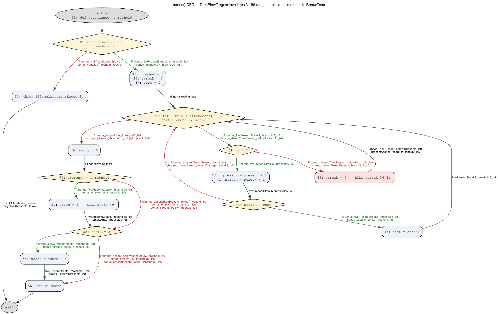

# Лаб 10: Өгөгдлийн урсгалын тест — Definition-Use хосууд

**F.CSA313 — Программ хангамжийн чанарын баталгаа ба тест (2026)**

| | |
|---|---|
| **Оюутан** | Д.Алтанбагана |
| **Оюутны код** | B222270827 |

## Орчин

```
$ java -version
openjdk version "26.0.1" 2026-04-21
OpenJDK Runtime Environment (build 26.0.1+8-34)
OpenJDK 64-Bit Server VM (build 26.0.1+8-34, mixed mode, sharing)

$ mvn -version
Apache Maven 3.10.1 (3afd8084b5629f80b97750906a719879ed4cd283)
Maven home: /opt/homebrew/Cellar/maven/3.10.1/libexec
Java version: 27.0.1.1, vendor: Homebrew, runtime: /opt/homebrew/Cellar/openjdk/27.0.1.1/libexec/openjdk.jdk/Contents/Home
Default locale: en_MN, platform encoding: UTF-8, time zone: Asia/Ulaanbaatar
OS name: "mac os x", version: "26.6.2", arch: "aarch64", family: "mac"
```

Starter-ийг (Teams → Lab10, `lab10-dataflow/`) өөрчлөлтгүй ашигласан: JUnit 5, JaCoCo, `maven.compiler.release=17`. Хүснэгт, CFG, тестийн тайлбар дахь бүх мөрийн дугаар нь `src/main/java/mn/edu/must/sqat/DataFlowTargets.java` файлын мөр.

## Хэсэг A: gcd — бүрэн DU хүснэгт

```java
13  public static int gcd(int x, int y) {   // def x, y
14      int tmp;                            // зөвхөн зарлалт — def биш (утга оноогоогүй)
15      while (y != 0) {                    // p-use y
16          tmp = x % y;                    // def tmp; c-use x, y
17          x = y;                          // def x;   c-use y
18          y = tmp;                        // def y;   c-use tmp
19      }
20      return x;                           // c-use x
```

Лекцийн дугаарлалтаас хөрвүүлэлт: 1 → 13, 3 → 15, 4 → 16, 5 → 17, 6 → 18, 8 → 20. p-use-ийг гарах ирмэг тус бүрээр (15→16 = T, 15→20 = F) тусад нь тоолсон.

| № | Хувьсагч | Def мөр | Use мөр | Төрөл | Def-clear зам | Тестийн ID | Хамрагдсан |
|---|---|---|---|---|---|---|---|
| 1 | x | 13 | 16 | c-use | 13 → 15 → 16 | G2, G3 | ✅ |
| 2 | x | 13 | 20 | c-use | 13 → 15 → 20 | **G1** | ✅ |
| 3 | x | 17 | 16 | c-use | 17 → 18 → 15 → 16 | **G3** | ✅ |
| 4 | x | 17 | 20 | c-use | 17 → 18 → 15 → 20 | G2, G3 | ✅ |
| 5 | y | 13 | (15, 16) | p-use T | 13 → 15 → 16 | G2, G3 | ✅ |
| 6 | y | 13 | (15, 20) | p-use F | 13 → 15 → 20 | **G1** | ✅ |
| 7 | y | 13 | 16 | c-use | 13 → 15 → 16 | G2, G3 | ✅ |
| 8 | y | 13 | 17 | c-use | 13 → 15 → 16 → 17 | G2, G3 | ✅ |
| 9 | y | 18 | (15, 16) | p-use T | 18 → 15 → 16 | **G3** | ✅ |
| 10 | y | 18 | (15, 20) | p-use F | 18 → 15 → 20 | G2, G3 | ✅ |
| 11 | y | 18 | 16 | c-use | 18 → 15 → 16 | **G3** | ✅ |
| 12 | y | 18 | 17 | c-use | 18 → 15 → 16 → 17 | **G3** | ✅ |
| 13 | tmp | 16 | 18 | c-use | 16 → 17 → 18 | G2, G3 | ✅ |

Нийт **13 DU хос**, бүгд хамрагдсан; биелэшгүй хос алга. Лекцийн хүснэгтэд ихэвчлэн дутуу үлддэг хосууд нь давталтын дотор дахин тодорхойлогдсон утгууд давталтын эхэнд эргэж ирэх хосууд (3, 9, 11, 12) ба давталтад огт орохгүй үеийн хосууд (2, 6) юм.

### Тестүүд (`src/test/java/mn/edu/must/sqat/GcdTest.java`)

| ID | Тест | Оролт → хүлээгдэх | Давталт | Хамрах хосууд |
|---|---|---|---|---|
| G1 | `gcd_zeroIterations_7_0_is7` | `gcd(7, 0)` → 7 | 0 | 2, 6 |
| G2 | `gcd_oneIteration_9_3_is3` | `gcd(9, 3)` → 3 | 1 | 1, 4, 5, 7, 8, 10, 13 |
| G3 | `gcd_twoIterations_12_8_is4` | `gcd(12, 8)` → 4 | 2 | 1, 3, 4, 5, 7–13 |

Тест бүрийн `@DisplayName`-д хамарч буй хосуудыг мөрийн дугаараар нь бичсэн.

- **`gcd(7, 0)` ганцаараа хамардаг хосууд:** `x(13, 20)` ба `y(13, 15→20)`. y = 0 тул давталтад огт орохгүй бөгөөд параметрийн def шууд `return`-д хүрдэг цорын ганц зам энэ. Давталтад нэг ч удаа орсон тест x-ийг 17-д, y-ийг 18-д дахин тодорхойлдог тул эдгээр хос «алагдана».
- **`gcd(12, 8)` нь 2 давталт хийдэг:** (12, 8) → (8, 4) → (4, 0). Давталтын 17/18-д тодорхойлсон утга дараагийн эргэлтийн 15/16/17-д хэрэглэгдэх хосууд (3, 9, 11, 12) нь **дор хаяж 2 давталт** шаарддаг тул нэг давталттай G2 тэднийг хамрахгүй. All-DU-pairs-д хамгийн багадаа G1 + G3 хангалттай. G2-ийг давталтын «1 удаа» заагийг тусад нь харуулахын тулд нэмсэн.

## Хэсэг B: bonus — бүрэн анализ

### B1 — CFG



`cfg-bonus.png` — зангилаа бүр файлын мөрийн дугаартай, ирмэг бүрт түүнийг дайрдаг тестийн нэр бичигдсэн. For-each давталтыг (38) нөхцөл = «attendance-д дараагийн элемент байгаа эсэх» (attendance-ийн p-use), алхам = «дараагийн элементийг a-д оноох» (a-ийн def) гэж задалсан.

| Зангилаа | Код | Ирмэгүүд |
|---|---|---|
| 31–32 | `attendance == null \|\| threshold < 0` | T → 33, F → 35–37 |
| 33 | `throw new IllegalArgumentException` | → exit |
| 35–37 | `present = 0; streak = 0; best = 0` | → 38 |
| 38 | `for (int a : attendance)` | T (дараагийн элемент бий, a-д оноох) → 39, F → 49 |
| 39 | `a > 0` | T → 40–41, F → 46 |
| 40–41 | `present = present + 1; streak = streak + 1` | → 42 |
| 42 | `streak > best` | T → 43, F → 38 |
| 43 | `best = streak` | → 38 |
| 46 | `streak = 0` | → 38 |
| 49 | `score = 0` | → 50 |
| 50 | `present >= threshold` | T → 51, F → 53 |
| 51 | `score = 5` | → 53 |
| 53 | `best >= 5` | T → 54, F → 56 |
| 54 | `score = score + 3` | → 56 |
| 56 | `return score` | → exit |

### B2 — Def/Use жагсаалт

```java
31  public static int bonus(int[] attendance, int threshold) {  // def attendance, threshold
32      if (attendance == null || threshold < 0) {               // p-use attendance, threshold
33          throw new IllegalArgumentException("Буруу оролт");
35      int present = 0;                                          // def present
36      int streak = 0;                                           // def streak
37      int best = 0;                                             // def best
38      for (int a : attendance) {                                // p-use attendance (дараагийн элемент бий эсэх); def a
39          if (a > 0) {                                          // p-use a
40              present = present + 1;                            // c-use present; def present
41              streak = streak + 1;                              // c-use streak;  def streak
42              if (streak > best) {                              // p-use streak, best
43                  best = streak;                                // c-use streak;  def best
46              streak = 0;                                       // def streak  (KILL: 36, 41-ийн def-ийг алдаг)
49      int score = 0;                                            // def score
50      if (present >= threshold) {                               // p-use present, threshold
51          score = 5;                                            // def score   (KILL: 49)
53      if (best >= 5) {                                          // p-use best
54          score = score + 3;                                    // c-use score; def score (KILL: 49, 51)
56      return score;                                             // c-use score
```

### B3 — DU хүснэгт

p-use-ийг гарах ирмэг тус бүрээр (T/F) тоолсон. Тестийн ID: D1–D2 — all-defs шат, D3–D8 — all-DU-pairs шат.

| № | Хувьсагч | Def | Use | Төрөл | Def-clear зам (жишээ) | Тестийн ID | Хамрагдсан |
|---|---|---|---|---|---|---|---|
| 1 | attendance | 31 | (32, T) | p-use | 31 → 32 → 33 | D3 | ✅ |
| 2 | attendance | 31 | (32, F) | p-use | 31 → 32 → 35 | D1, D2, D5–D8 | ✅ |
| 3 | attendance | 31 | (38, T) | p-use | 31 → 32 → 35–37 → 38 → 39 | D1, D2, D7, D8 | ✅ |
| 4 | attendance | 31 | (38, F) | p-use | 31 → 32 → 35–37 → 38 → 49 | D5, D6 (шууд), бусад нь давталтын төгсгөлд | ✅ |
| 5 | threshold | 31 | (32, T) | p-use | 31 → 32 → 33 | D4 | ✅ |
| 6 | threshold | 31 | (32, F) | p-use | 31 → 32 → 35 | D1, D2, D5–D8 | ✅ |
| 7 | threshold | 31 | (50, T) | p-use | 31 → … → 50 → 51 | D1, D5, D7 | ✅ |
| 8 | threshold | 31 | (50, F) | p-use | 31 → … → 50 → 53 | D2, D6, D8 | ✅ |
| 9 | present | 35 | 40 | c-use | 35 → 38 → 39 → 40 | D1, D2 | ✅ |
| 10 | present | 35 | (50, T) | p-use | 35 → 38 → 49 → 50 → 51 (ирсэн өдөргүй) | D5 | ✅ |
| 11 | present | 35 | (50, F) | p-use | 35 → 38 → 49 → 50 → 53 (ирсэн өдөргүй) | D6 | ✅ |
| 12 | present | 40 | 40 | c-use | 40 → 41 → 42 → (43) → 38 → 39 → 40 | D1, D7 | ✅ |
| 13 | present | 40 | (50, T) | p-use | 40 → … → 38 → 49 → 50 → 51 | D1, D7 | ✅ |
| 14 | present | 40 | (50, F) | p-use | 40 → … → 38 → 49 → 50 → 53 | D2, D8 | ✅ |
| 15 | streak | 36 | 41 | c-use | 36 → 37 → 38 → 39 → 40 → 41 (эхний өдөр ирсэн) | D1, D7, D8 | ✅ |
| 16 | streak | 41 | 41 | c-use | 41 → 42 → (43) → 38 → 39 → 40 → 41 | D1, D8 | ✅ |
| 17 | streak | 41 | (42, T) | p-use | 41 → 42 → 43 | D1, D2, D7, D8 | ✅ |
| 18 | streak | 41 | (42, F) | p-use | 41 → 42 → 38 | **D7** | ✅ |
| 19 | streak | 41 | 43 | c-use | 41 → 42 → 43 | D1, D2, D7, D8 | ✅ |
| 20 | streak | 46 | 41 | c-use | 46 → 38 → 39 → 40 → 41 (тасалсны дараа ирсэн) | D2, D7 | ✅ |
| 21 | best | 37 | (42, T) | p-use | 37 → 38 → 39 → 40 → 41 → 42 → 43 | D1, D2, D7, D8 | ✅ |
| 22 | best | 37 | (42, F) | p-use | — | — | ⛔ биелэшгүй |
| 23 | best | 37 | (53, T) | p-use | — | — | ⛔ биелэшгүй |
| 24 | best | 37 | (53, F) | p-use | 37 → 38 → 49 → 50 → 53 → 56 (ирсэн өдөргүй) | D5, D6 | ✅ |
| 25 | best | 43 | (42, T) | p-use | 43 → 38 → 39 → 40 → 41 → 42 → 43 | D1, D8 | ✅ |
| 26 | best | 43 | (42, F) | p-use | 43 → 38 → 39 → 46 → 38 → 39 → 40 → 41 → 42 → 38 | **D7** | ✅ |
| 27 | best | 43 | (53, T) | p-use | 43 → 38 → 49 → 50 → … → 53 → 54 | D1, D8 | ✅ |
| 28 | best | 43 | (53, F) | p-use | 43 → … → 53 → 56 | D2, D7 | ✅ |
| 29 | a | 38 | (39, T) | p-use | 38 → 39 → 40 | D1, D2, D7, D8 | ✅ |
| 30 | a | 38 | (39, F) | p-use | 38 → 39 → 46 | D2, D7 | ✅ |
| 31 | score | 49 | 54 | c-use | 49 → 50 → 53 → 54 (50 худал) | **D8** | ✅ |
| 32 | score | 49 | 56 | c-use | 49 → 50 → 53 → 56 (50, 53 хоёул худал) | D2, D6 | ✅ |
| 33 | score | 51 | 54 | c-use | 51 → 53 → 54 | D1 | ✅ |
| 34 | score | 51 | 56 | c-use | 51 → 53 → 56 | D5, D7 | ✅ |
| 35 | score | 54 | 56 | c-use | 54 → 56 | D1, D8 | ✅ |

Нийт **35 хос**: 33 биелэх боломжтой — бүгд хамрагдсан, 2 биелэшгүй.

**Биелэшгүй хосын үндэслэл:**
- **№22 best(37) → (42, F):** 42-т хүрэхэд 41 дээр streak дор хаяж 1 болсон байдаг, харин best 37-ийн утгаараа (0) байх цорын ганц үе бол эхний ирсэн өдөр; тэр үед `1 > 0` үргэлж үнэн тул F салаа best = 0 үед хэзээ ч биелэхгүй.
- **№23 best(37) → (53, T):** best 37-ийн def-ээр 53-т хүрнэ гэдэг нь нэг ч ирсэн өдөр байгаагүй (43 огт ажиллаагүй) гэсэн үг, тэгвэл best = 0 бөгөөд `0 >= 5` үргэлж худал.

**Kill (дахин тодорхойлолт) — DU хос гэж тоолоогүй хослолууд:**
- **46-ын `streak = 0`** нь 36 ба 41-ийн streak-ийн def-ийг алдаг: тасалсан өдрөөр дамжсан замаар эдгээр def дараагийн 41/42/43-т хүрэхгүй (№15, №16 зөвхөн 46-гүй замаар хангагдана).
- **streak(36) → 42, streak(36) → 43, streak(46) → 42, streak(46) → 43 — DU хос биш:** 38 → 39 → 42 бүх зам 41-ээр дамждаг бөгөөд 41 streak-ийг дахин тодорхойлдог тул 36 ба 46-ийн def-ээс 42/43 хүрэх def-clear зам огт байхгүй.
- **score(49)** 51 ба 54-т, **score(51)** 54-т алагдана: тиймээс №31 (49 → 54) нь зөвхөн 50 худал үед, №32 (49 → 56) нь 50 ба 53 хоёул худал үед л def-clear.
- **best(37)** нь 43-т алагдана: №24 зөвхөн ирсэн өдөргүй гүйцэтгэлд (хоосон массив эсвэл бүгд тасалсан) хангагдана.

### B4 — Шат 2: ALL-DU-PAIRS (нэмэлт 6 тест, нийт 8)

| ID | Тест | Оролт → хүлээгдэх | Шинээр хамарсан хосууд |
|---|---|---|---|
| D3 | `bonus_nullAttendance_throws` | `bonus(null, 3)` → IAE | №1 |
| D4 | `bonus_negativeThreshold_throws` | `bonus([1], -1)` → IAE | №5 |
| D5 | `bonus_emptyArray_threshold0_is5` | `bonus([], 0)` → 5 | №10, 24, 34 |
| D6 | `bonus_emptyArray_threshold1_is0` | `bonus([], 1)` → 0 | №11 |
| D7 | `bonus_presentAbsentPresent_threshold2_is5` | `bonus([1,0,1], 2)` → 5 | №18, 26 |
| D8 | `bonus_streak5_belowThreshold_is3` | `bonus([1,1,1,1,1], 6)` → 3 | №31 |

Шат 2-ын дараа `mvn verify`: Tests run: **11** (GcdTest 3 + BonusTest 8), Branch 16/16. Эцсийн тоог B5-д `results/`-ээс өгнө.


### B4 — Шат 1: ALL-DEFS (2 тест)

| ID | Тест | Оролт → хүлээгдэх |
|---|---|---|
| D1 | `bonus_fivePresentStreak5_threshold5_is8` | `bonus([1,1,1,1,1], 5)` → 8 |
| D2 | `bonus_absentThenPresent_belowThreshold_is0` | `bonus([0,1], 5)` → 0 |

**Яагаад 2 тест, түүнээс цөөн болохгүй вэ:** `score`-ийн гурван def (49, 51, 54) байна. 49-ийн `score = 0` нь use-д (54 эсвэл 56) зөвхөн `present >= threshold` **худал** (50 → 53) үед def-clear замаар хүрнэ; харин 51-ийн `score = 5` зөвхөн 50 **үнэн** үед тодорхойлогдоно, тэгэхэд 49-ийн def 51-д алагдана. Нэг гүйцэтгэлд 50-ын нөхцөл нэг л утга авах тул 49 ба 51-ийн def-үүдийг хоёуланг нь use-д хүргэх **нэг тест байхгүй** → хамгийн багадаа 2 тест. Мөн streak-ийн 46-ын def (`streak = 0`) цорын ганц use-тэй нь (41) зөвхөн тасалсан өдрийн **дараа ирсэн өдөр** байвал холбогдоно — D2 (`[0,1]`) үүнийг хангана. D1 нь 54-ийн def-ийг (best ≥ 5) ба 51 → 54-ийг, D2 нь 49 → 56 ба 46 → 41-ийг хангадаг тул хоёулаа хамт бүх def-ийг дор хаяж нэг use-д хүргэнэ.

`results/mvn-verify-alldefs.txt`: Tests run: **5** (GcdTest 3 + BonusTest 2), Failures: 0, BUILD SUCCESS.

`results/jacoco-alldefs.csv`: `BRANCH_MISSED = 3`, `BRANCH_COVERED = 13` → Branch 13/16 = **81.25%**; `LINE_MISSED = 2`, `LINE_COVERED = 22` → Line 22/24. Хамрагдаагүй: 32-ын 2 салаа (`attendance == null` ба `threshold < 0` үнэн), 42-ын F салаа (`streak > best` худал), мөр 33 (`throw`) ба мөр 7 (далд constructor). **All-defs хангагдсан ч branch 100% биш** — all-defs нь def бүрийг нэг use-д хүргэхийг л шаарддаг тул алдааны зам болон p-use-ийн хоёр дахь салааг шалгахгүй орхиж болдог.
